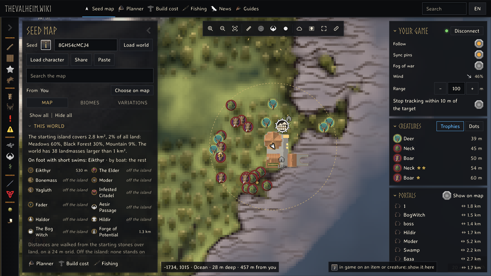
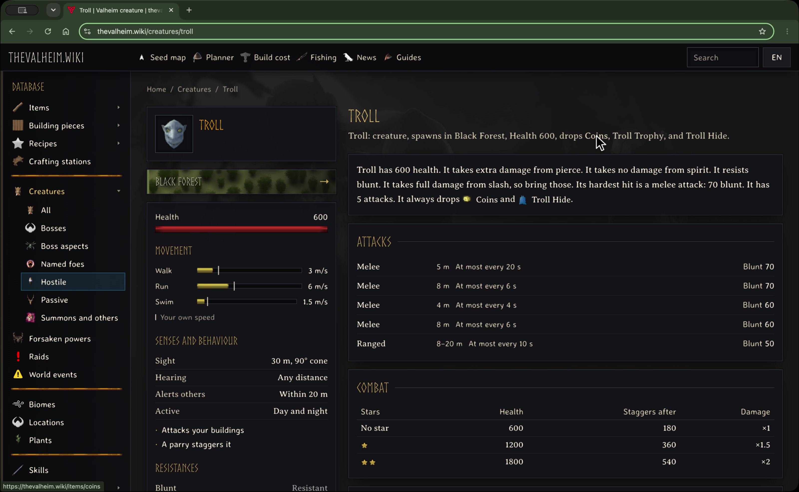

# Live Seed Map

A realtime map of your Valheim server in a browser, connected to the game data
at [thevalheim.wiki](https://thevalheim.wiki/map) through the Live Seed Map
companion mod.



Game data includes creature stats and drops.



## Install

Get the mod on [Thunderstore](https://thunderstore.io/c/valheim/p/TheValheimWiki/LiveSeedMap/)
or from this repository's releases. Follow the
[installation guide](https://thevalheim.wiki/guides/live-seed-map).
Apple Silicon players use the [macOS guide](https://thevalheim.wiki/guides/mods-on-mac).

See real screenshots and installation instructions in [the mod README](LiveSeedMap/README.md).

## Build

The source targets .NET Standard 2.1. Install a .NET SDK, Valheim and BepInEx,
then build against your own installation:

```sh
dotnet build LiveSeedMap/LiveSeedMap.csproj --configuration Release \
  -p:ValheimRoot="/path/to/Valheim" \
  -p:Managed="/path/to/Valheim/valheim_Data/Managed" \
  -p:BepInExCore="/path/to/BepInEx/core"
```

On macOS, `Managed` is inside
`valheim.app/Contents/Resources/Data/Managed`. Game assemblies are references
and are not distributed with this mod.

## Support

Support development at [Ko-fi](https://ko-fi.com/thevalheimwiki).
The site, game data and map are at [thevalheim.wiki](https://thevalheim.wiki).
